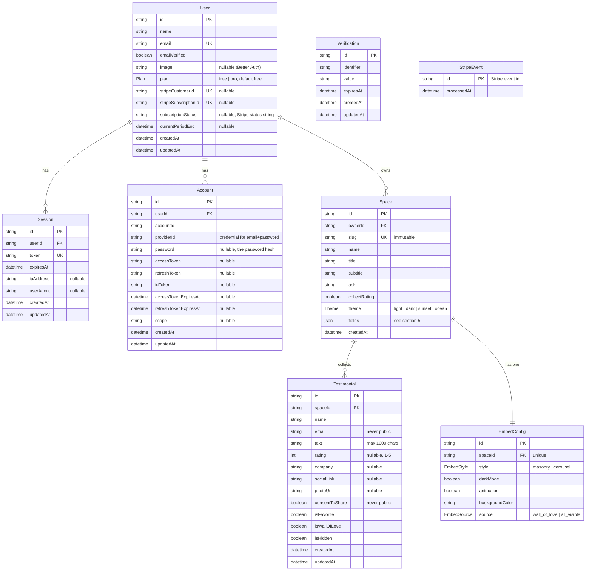

# Testimonial Collector — Data Model

Design document for the database schema. Derived from PRD section 4 (Data Model),
section 2 (Plans & Limits), section 5.3 (theme values and field keys only) and
section 5.9 (limit states). Auth is handled by **Better Auth** with the Prisma adapter;
its required tables are included below and its `User` table is extended with the PRD's
User fields rather than duplicated.

Decisions already taken: Better Auth, full cascade deletes, `subscriptionStatus` stored
as Stripe's raw string. Open points are listed at the end.

---

## 1. ER diagram



---

## 2. Tables

Column origin: **PRD** = PRD section 4, **BA** = required by Better Auth.

### Enums (PostgreSQL)

| Enum | Values | Used by |
| --- | --- | --- |
| `Plan` | `free`, `pro` | `User.plan` |
| `Theme` | `light`, `dark`, `sunset`, `ocean` | `Space.theme` |
| `EmbedStyle` | `masonry`, `carousel` | `EmbedConfig.style` |
| `EmbedSource` | `wall_of_love`, `all_visible` | `EmbedConfig.source` |

### User

Better Auth's core user table extended with the PRD fields. One table, no duplicate.

| Column | Type | Null | Default | Origin | Notes |
| --- | --- | --- | --- | --- | --- |
| `id` | String | no | cuid | PRD + BA | |
| `name` | String | no | | PRD + BA | |
| `email` | String | no | | PRD + BA | unique, case-insensitive compare in app |
| `emailVerified` | Boolean | no | `false` | BA | |
| `image` | String | yes | | BA | unused by the MVP, required by Better Auth |
| `plan` | `Plan` | no | `free` | PRD | written only by the Stripe webhook |
| `stripeCustomerId` | String | yes | | PRD | unique |
| `stripeSubscriptionId` | String | yes | | PRD | unique |
| `subscriptionStatus` | String | yes | | PRD | Stripe's `subscription.status` as-is (`active`, `trialing`, `past_due`, `canceled`, `unpaid`, `incomplete`, `incomplete_expired`, `paused`) |
| `currentPeriodEnd` | DateTime | yes | | PRD | from the subscription |
| `createdAt` | DateTime | no | `now()` | PRD + BA | |
| `updatedAt` | DateTime | no | `@updatedAt` | BA | |

**`passwordHash` is not a User column.** The PRD says `passwordHash (or provider)`. With
Better Auth's email + password plugin the hash lives in `Account.password` on the row
where `providerId = "credential"`. This satisfies the PRD without a second hash location.

### Session (Better Auth)

| Column | Type | Null | Notes |
| --- | --- | --- | --- |
| `id` | String | no | PK |
| `userId` | String | no | FK → User |
| `token` | String | no | unique |
| `expiresAt` | DateTime | no | |
| `ipAddress` | String | yes | |
| `userAgent` | String | yes | |
| `createdAt` | DateTime | no | |
| `updatedAt` | DateTime | no | |

### Account (Better Auth)

| Column | Type | Null | Notes |
| --- | --- | --- | --- |
| `id` | String | no | PK |
| `userId` | String | no | FK → User |
| `accountId` | String | no | for `credential` rows this equals the user id |
| `providerId` | String | no | `credential` for email + password |
| `password` | String | yes | the password hash (PRD's `passwordHash`) |
| `accessToken` | String | yes | OAuth only, unused in MVP |
| `refreshToken` | String | yes | OAuth only, unused in MVP |
| `idToken` | String | yes | OAuth only, unused in MVP |
| `accessTokenExpiresAt` | DateTime | yes | OAuth only |
| `refreshTokenExpiresAt` | DateTime | yes | OAuth only |
| `scope` | String | yes | OAuth only |
| `createdAt` | DateTime | no | |
| `updatedAt` | DateTime | no | |

### Verification (Better Auth)

Backs the password-reset link (PRD 5.1). No application fields.

| Column | Type | Null | Notes |
| --- | --- | --- | --- |
| `id` | String | no | PK |
| `identifier` | String | no | e.g. the email or a reset key |
| `value` | String | no | the token |
| `expiresAt` | DateTime | no | |
| `createdAt` | DateTime | no | |
| `updatedAt` | DateTime | no | |

### Space

| Column | Type | Null | Default | Notes |
| --- | --- | --- | --- | --- |
| `id` | String | no | cuid | |
| `ownerId` | String | no | | FK → User; every dashboard query filters on this |
| `slug` | String | no | | unique, kebab-case from `name` + random suffix if taken, **immutable** |
| `name` | String | no | | internal name shown on the space card |
| `title` | String | no | | heading on the public page |
| `subtitle` | String | no | | |
| `ask` | String | no | | the question/prompt text |
| `collectRating` | Boolean | no | `true` | 1–5 stars toggle |
| `theme` | `Theme` | no | `light` | |
| `fields` | Json | no | see section 5 | `[{key, enabled, required}]` |
| `createdAt` | DateTime | no | `now()` | |

### Testimonial

| Column | Type | Null | Default | Notes |
| --- | --- | --- | --- | --- |
| `id` | String | no | cuid | |
| `spaceId` | String | no | | FK → Space |
| `name` | String | no | | |
| `email` | String | no | | **never in public output** |
| `text` | VarChar(1000) | no | | plain text, max 1,000 chars (CLAUDE.md rule 8) |
| `rating` | Int | yes | | 1–5; null when the space does not collect ratings |
| `company` | String | yes | | |
| `socialLink` | String | yes | | URL |
| `photoUrl` | String | yes | | upload provider URL |
| `consentToShare` | Boolean | no | | **never in public output**; public pages require `true` |
| `isFavorite` | Boolean | no | `false` | owner flag |
| `isWallOfLove` | Boolean | no | `false` | owner flag, feeds the `wall_of_love` embed source |
| `isHidden` | Boolean | no | `false` | owner flag |
| `createdAt` | DateTime | no | `now()` | |
| `updatedAt` | DateTime | no | `@updatedAt` | |

### EmbedConfig

One row per space (1:1), created lazily the first time the embed builder is opened or
eagerly on space creation (implementation choice; the schema allows both).

| Column | Type | Null | Default | Notes |
| --- | --- | --- | --- | --- |
| `id` | String | no | cuid | |
| `spaceId` | String | no | | FK → Space, unique |
| `style` | `EmbedStyle` | no | `masonry` | |
| `darkMode` | Boolean | no | `false` | |
| `animation` | Boolean | no | `true` | |
| `backgroundColor` | String | no | `#ffffff` | hex colour, validated by Zod |
| `source` | `EmbedSource` | no | `all_visible` | |

### StripeEvent

| Column | Type | Null | Default | Notes |
| --- | --- | --- | --- | --- |
| `id` | String | no | | PK, the Stripe event id (`evt_…`); insert-before-process makes the webhook idempotent |
| `processedAt` | DateTime | no | `now()` | |

---

## 3. Relationships and delete behavior

| Parent | Child | Cardinality | FK column | On delete | On update | Why |
| --- | --- | --- | --- | --- | --- | --- |
| User | Session | 1 : n | `Session.userId` | Cascade | Cascade | Better Auth expects sessions to vanish with the user |
| User | Account | 1 : n | `Account.userId` | Cascade | Cascade | credential row (password hash) goes with the user |
| User | Space | 1 : n | `Space.ownerId` | Cascade | Cascade | deleting an account removes everything they own |
| Space | Testimonial | 1 : n | `Testimonial.spaceId` | Cascade | Cascade | PRD 5.3: deleting a space permanently deletes its testimonials |
| Space | EmbedConfig | 1 : 1 | `EmbedConfig.spaceId` (unique) | Cascade | Cascade | config is meaningless without its space |
| — | Verification | standalone | — | — | — | rows expire; cleaned up by Better Auth |
| — | StripeEvent | standalone | — | — | — | audit/idempotency log, never deleted by the app |

No soft deletes. `Testimonial.isHidden` is a visibility flag, not a deletion.
Pro → Free downgrade deletes nothing (PRD section 2); it only changes derived read-only state.

---

## 4. Indexes and constraints

### Unique constraints

| Table | Columns | Reason |
| --- | --- | --- |
| User | `email` | login identity |
| User | `stripeCustomerId` | webhook lookup `customer → user` |
| User | `stripeSubscriptionId` | webhook lookup `subscription → user` |
| Session | `token` | Better Auth session lookup |
| Account | `(providerId, accountId)` | one credential row per user |
| Space | `slug` | public URL `/s/[slug]`, `/embed/[slug]` |
| EmbedConfig | `spaceId` | enforces 1 : 1 |

### Indexes

| Table | Columns | Query it serves |
| --- | --- | --- |
| Session | `userId` | list/revoke a user's sessions |
| Account | `userId` | find credential row at login |
| Verification | `identifier` | password-reset token lookup |
| Space | `(ownerId, createdAt)` | spaces list, space-count limit check, "oldest N stay writable" after downgrade |
| Testimonial | `(spaceId, createdAt)` | inbox listing, testimonial-count limit check |
| Testimonial | `(spaceId, isHidden, consentToShare)` | public page and `all_visible` embed |
| Testimonial | `(spaceId, isWallOfLove)` | `wall_of_love` embed source |

### Constraints beyond uniqueness

| Rule | Enforced where |
| --- | --- |
| `Testimonial.text` ≤ 1,000 characters | column type `VarChar(1000)` + Zod on the public form |
| `Testimonial.rating` between 1 and 5, required iff `Space.collectRating` | Zod; optional `CHECK (rating BETWEEN 1 AND 5)` added by hand in the migration |
| `Testimonial.email` is a valid email, `socialLink` a valid URL | Zod |
| `Space.slug` immutable | never present in any update schema or form; generated once on create |
| `Space.fields` well-formed (section 5), `required ⇒ enabled`, `name`/`email` locked on | Zod on create/update |
| `EmbedConfig.backgroundColor` is `#rrggbb` | Zod |
| Space limit per plan (403) / testimonial limit per space (409) | route handler or server action using `lib/plans.ts`, inside a transaction with the count |
| Ownership: all dashboard reads/writes filter by `ownerId` (spaces) or `space.ownerId` (testimonials, embed config); foreign ids return 404 | query layer |
| Public output excludes `email` and `consentToShare`; shows only `isHidden = false AND consentToShare = true` | explicit `select` in public/embed queries |

---

## 5. Shape of `Space.fields`

Ordered array of the public-form fields. Keys are fixed (PRD 5.3): `name` and `email` are
always on and always required; `company`, `socialLink` and `photo` are optional with an
on/off switch and a required toggle. Turning a field off hides it on the form only;
existing testimonials keep their data.

```json
[
  { "key": "name",       "enabled": true,  "required": true  },
  { "key": "email",      "enabled": true,  "required": true  },
  { "key": "company",    "enabled": false, "required": false },
  { "key": "socialLink", "enabled": false, "required": false },
  { "key": "photo",      "enabled": false, "required": false }
]
```

The array above is also the default for a new space.

Validation outline (Zod, server side):

```ts
const FIELD_KEYS = ["name", "email", "company", "socialLink", "photo"] as const;

const spaceField = z.object({
  key: z.enum(FIELD_KEYS),
  enabled: z.boolean(),
  required: z.boolean(),
}).refine((f) => !f.required || f.enabled, "required implies enabled");

export const spaceFieldsSchema = z.array(spaceField)
  .length(FIELD_KEYS.length)
  .refine((arr) => new Set(arr.map((f) => f.key)).size === FIELD_KEYS.length, "each key once")
  .refine((arr) => arr.filter((f) => f.key === "name" || f.key === "email")
                       .every((f) => f.enabled && f.required), "name and email are locked on");
```

Mapping to `Testimonial` columns: `name → name`, `email → email`, `company → company`,
`socialLink → socialLink`, `photo → photoUrl`. `rating` is governed by `Space.collectRating`,
not by `fields`.

---

## 6. Plan-limit constants

Single source of plan numbers, to be created later as `lib/plans.ts`. Nothing here is stored
in the database; `User.plan` is the only persisted plan fact.

```ts
export const PLAN_LIMITS = {
  free: { spaces: 3,  testimonialsPerSpace: 100  },
  pro:  { spaces: 25, testimonialsPerSpace: 1000 },
} as const;

export const TESTIMONIAL_WARNING_RATIO = 0.9;   // owner warning at 90% and 100%
export const PRO_PRICE_USD_MONTHLY = 9.99;      // display only; Stripe price id comes from env
```

| Limit hit | HTTP status | UI (PRD 5.9) |
| --- | --- | --- |
| Space limit | 403 | "New space" opens an upgrade prompt |
| Testimonial limit | 409 | public page: "This space isn't accepting testimonials right now" |

---

## 7. Derived values (not stored)

| Value | Computed from | Used for |
| --- | --- | --- |
| Space count per owner | `COUNT(Space) WHERE ownerId` | 403 check, dashboard overview |
| Testimonial count per space | `COUNT(Testimonial) WHERE spaceId` | 409 check, space card, 90% / 100% warning |
| Percent of testimonial limit used | count ÷ `PLAN_LIMITS[plan].testimonialsPerSpace` | owner warning banner |
| At space limit / at testimonial limit | count ≥ limit | block creation; public page "not accepting" state |
| "Powered by" badge shown | `User.plan === "free"` of the space owner | public page and embed |
| Read-only after Pro → Free downgrade | spaces beyond the first `PLAN_LIMITS.free.spaces` by `createdAt`, and testimonials beyond `100` per space | PRD section 2: data kept, overflow read-only, nothing deleted |
| Publicly visible testimonial | `isHidden = false AND consentToShare = true` | `/s/[slug]`, `/embed/[slug]` |
| Wall-of-love set | publicly visible AND `isWallOfLove = true` | `wall_of_love` embed source |
| Public link | `APP_URL + "/s/" + slug` | space card, success page, inbox empty state |
| Embed snippet | `APP_URL + "/embed.js"` + `data-slug` | embed builder |
| Current session user | Better Auth session token → `Session` → `User` | all dashboard scoping |

---

## 8. Open points (not settled by PRD section 4)

1. **`subscriptionStatus` as a string** rather than a Postgres enum, so new Stripe statuses
   cannot break the webhook. Flip to an enum if you prefer strictness.
2. **Which spaces stay writable after a downgrade.** Proposal: the 3 oldest by `createdAt`.
   Alternative: let the owner pick. Needs a decision before the billing feature.
3. **Rate limiting** (CLAUDE.md rule 8) has no table here. If in-memory limiting is not enough
   on the hosting target, a counter table will be proposed separately before being added.
4. **`Space.updatedAt`** is not in the PRD and is therefore omitted. Say so if you want it.
5. **`EmbedConfig` creation timing** (eager on space create vs lazy on first builder open) is
   left to the implementation; the schema supports both.
